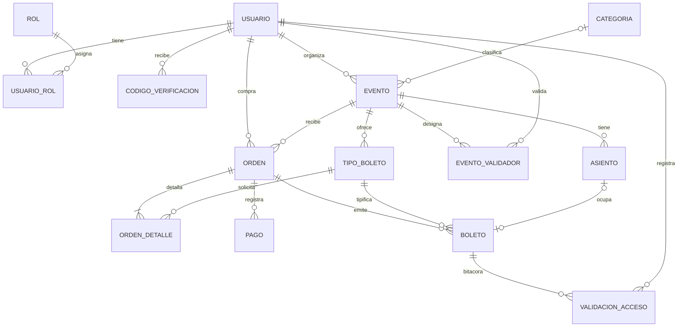

# Modelo de datos

- **Motor:** PostgreSQL 15.
- **Migraciones:** Flyway, en `src/main/resources/db/migration`.
- **Fuente de verdad:** el esquema lo definen solo las migraciones. Hibernate no lo crea ni lo modifica (`ddl-auto: none`).
- **Integridad:** las reglas que pueden expresarse en SQL (CHECK, UNIQUE, llaves foráneas, índices parciales) viven en la base de datos como red de seguridad.

## Diagrama entidad-relación



## Entidades principales

| Tabla | Propósito | Reglas destacadas |
|---|---|---|
| `usuario` | Cuenta de la plataforma | Correo único. `curp` cifrado con AES-256-GCM; `curp_hash` (HMAC) es único y permite buscarlo. Contraseña en BCrypt. Estado `PENDIENTE`, `ACTIVO` o `BLOQUEADO`. Intentos fallidos y bloqueo temporal |
| `rol`, `usuario_rol` | Roles acumulables | ASISTENTE, ORGANIZADOR, VALIDADOR, ADMIN |
| `codigo_verificacion` | Códigos de un solo uso (RF-02) | Solo el hash del código. Canal CORREO o TELEFONO. Vencimiento e intentos |
| `categoria` | Catálogo | Nombre único |
| `evento` | Evento publicable | `aforo > 0`. Fin ≥ inicio. Latitud y longitud dentro de rango y en pares. Estado BORRADOR, PUBLICADO, REALIZADO o CANCELADO. Fecha, autor y motivo de cancelación |
| `tipo_boleto` | Modalidad de entrada e inventario | `precio ≥ 0`. `cantidad_disponible ≤ cantidad_total`: barrera declarativa contra la sobreventa |
| `asiento` | Butaca | Única por (evento, sección, fila, número). Estado DISPONIBLE, RESERVADO u OCUPADO |
| `evento_validador` | Personal de acceso por evento | Llave (evento, usuario) |
| `orden` | Compra o confirmación | `total ≥ 0`. `clave_operacion` única por asistente (idempotencia). `expira_en` de la reserva. Estado PENDIENTE, PAGADA, CANCELADA o REEMBOLSADA |
| `orden_detalle` | Lo pedido en la orden | Tipo, cantidad, precio confirmado y `asientos_ids` (vacío o igual a la cantidad) |
| `pago` | Movimiento contra la pasarela | Solo referencias, nunca datos de tarjeta. Estado APROBADO, RECHAZADO o REEMBOLSADO. Referencia y fecha de reembolso |
| `boleto` | Entrada firmada de un solo uso | `codigo` único. `qr_firma` HMAC obligatoria. Un asiento no puede tener dos boletos vigentes (índice parcial). Estado VALIDO, USADO, CANCELADO o EXPIRADO |
| `validacion_acceso` | Bitácora de accesos | Resultado, motivo, validador, si fue sin conexión y si se sincronizó |

## Máquinas de estado

```
Evento:  BORRADOR ──publicar──▶ PUBLICADO ──(terminó)──▶ REALIZADO
              └────────cancelar────────┴──▶ CANCELADO

Orden:   PENDIENTE ──pago aprobado / confirmación gratuita──▶ PAGADA ──evento cancelado + reembolso──▶ REEMBOLSADA
             └──pago rechazado / reserva vencida / evento cancelado──▶ CANCELADA

Boleto:  VALIDO ──primer escaneo──▶ USADO
            ├──evento cancelado──▶ CANCELADO
            └──evento realizado sin uso──▶ EXPIRADO

Asiento: DISPONIBLE ──reserva──▶ RESERVADO ──pago──▶ OCUPADO
                         └──rechazo / vencimiento──▶ DISPONIBLE
```

## Concurrencia (RNF-05)

Los cambios de inventario y de uso se hacen con actualizaciones condicionales, nunca leyendo y escribiendo desde Java:

```sql
-- Reserva de N lugares: 0 filas afectadas = aforo agotado (409)
UPDATE tipo_boleto SET cantidad_disponible = cantidad_disponible - :n
 WHERE id = :id AND cantidad_disponible >= :n;

-- Uso único del boleto: solo el primer escaneo afecta la fila
UPDATE boleto SET estado = 'USADO', fecha_uso = :ahora
 WHERE id = :id AND estado = 'VALIDO';
```

## Migraciones

| Versión | Contenido |
|---|---|
| V1 | Esquema base (modelo relacional v2 con geolocalización), roles y categorías |
| V2 | Índice ciego del CURP, bloqueo de sesión y códigos de verificación |
| V3 | Coordenadas en pares, datos de cancelación, validadores por evento e índices |
| V4 | Detalle de orden (compra múltiple), idempotencia, expiración de reservas, asiento vigente único y reembolsos |
| V5 | Motivo del rechazo en la bitácora e índice por código de boleto |

Si la base ya se creó con `esquema_enzona_v2.sql`, Flyway la toma como versión 1 (`baseline-on-migrate`) y aplica V2 a V5.

**No vuelvas a ejecutar `esquema_enzona_v2.sql` sobre una base con datos:** contiene `DROP TABLE … CASCADE`.
